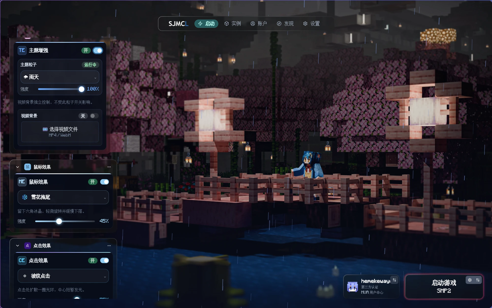
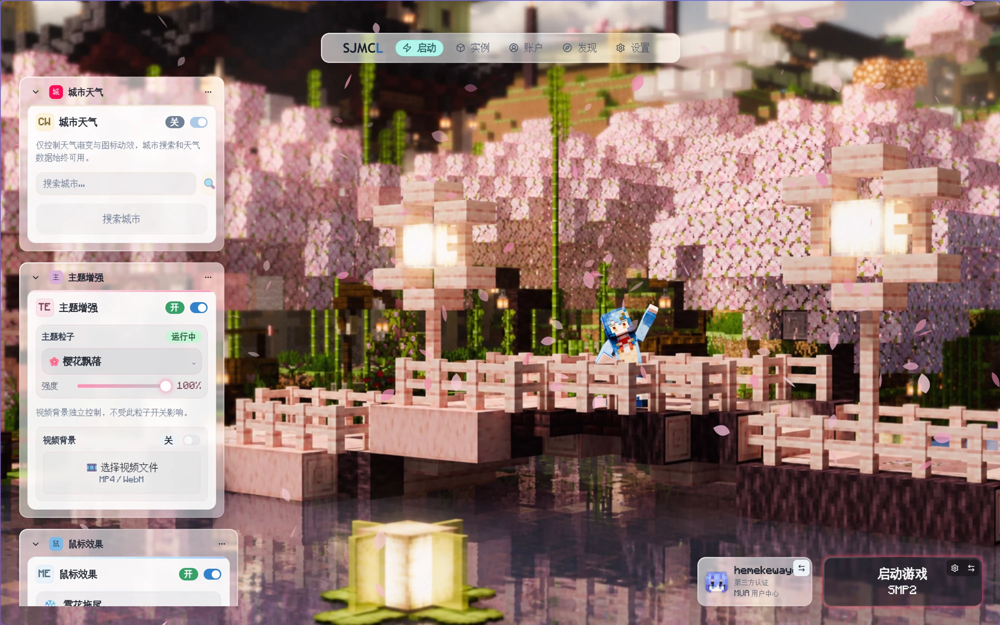
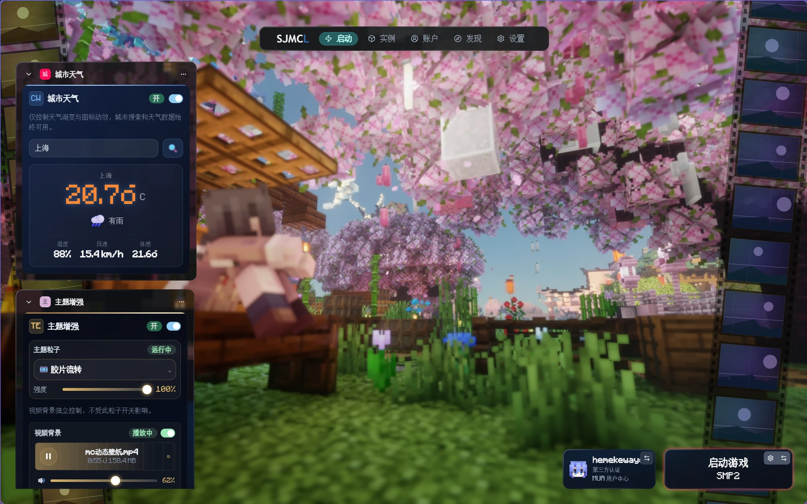
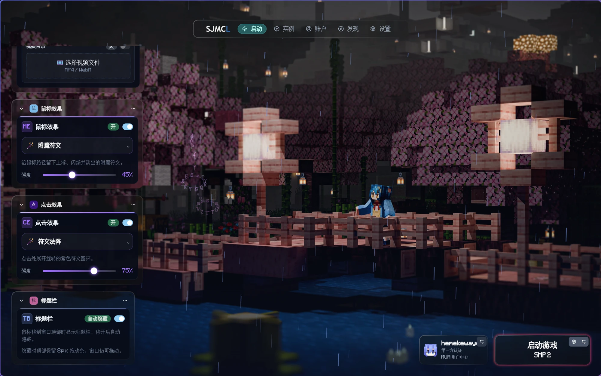
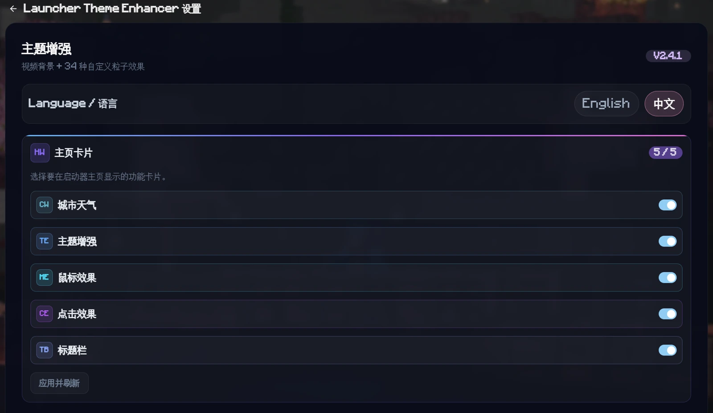
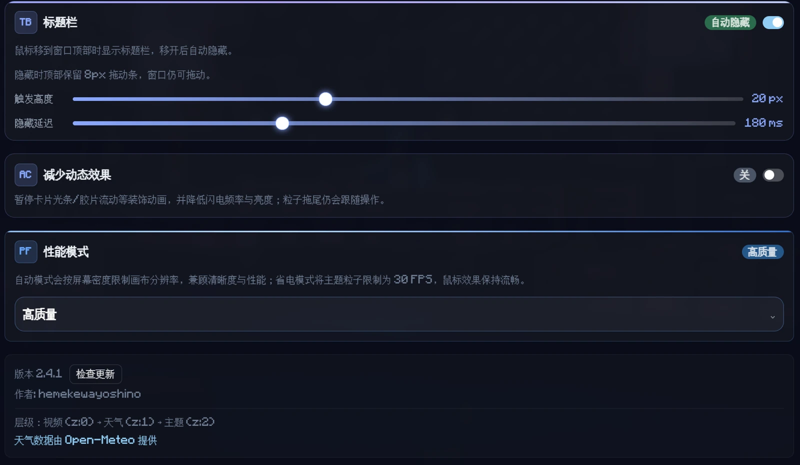

<div align="center">

  <h1>Launcher Theme Enhancer</h1>

  <p>天气、动态视频、34 种主题粒子、13 种鼠标拖尾、6 种点击效果与自动隐藏标题栏，一个扩展全部收下。</p>

  <p>
    <a href="https://github.com/YoshinoHdq/SJMCL-Launcher_Theme_Enhancer/releases/latest">
      
    </a>
    
    
  </p>

  <p><a href="README.en.md">English</a> · <b>简体中文</b></p>

  <a href="docs/images/overview-dark.webp">
    
  </a>

  <p><sub>深色主题 · 主题增强、鼠标效果与点击效果可同时运行</sub></p>

</div>

## 快速开始

| 1 | 2 | 3 |
| :---: | :---: | :---: |
| **下载** 从 Releases 获取 `.sjmclx` | **导入** 设置 → 扩展 → 添加 | **启用** 勾选扩展并刷新列表 |

> 最低启动器版本 `1.1.3`；标题栏自动隐藏需要 `1.3.0+`，推荐使用 `1.3.2`。
>
> 与 `sjmcl-video-background`、`sjmcl-weather-effects`、`sjmcl-city-weather`、`Auto Titlebar` 等旧独立插件不兼容，请先卸载旧插件。

[下载最新版本](https://github.com/YoshinoHdq/SJMCL-Launcher_Theme_Enhancer/releases/latest) · [查看更新记录](https://github.com/YoshinoHdq/SJMCL-Launcher_Theme_Enhancer/blob/main/CHANGELOG.md)

## 五张首页卡片

| 卡片 | 主要内容 |
| --- | --- |
| **城市天气** | 按城市查询实时天气，动态渐变与图标氛围可独立关闭 |
| **主题增强** | 34 种主题粒子、强度调节，以及独立的视频背景控制 |
| **鼠标效果** | 13 种光标拖尾、强度调节和独立开关 |
| **点击效果** | 6 种点击反馈、强度调节和独立开关 |
| **标题栏** | 顶部自动隐藏、8px 拖动条、触发高度与隐藏延迟 |

设置页可以逐张控制这些卡片是否显示在启动器主页，当前状态会以 `5 / 5` 的形式展示。隐藏卡片只影响主页显示，不会自动关闭对应的粒子、拖尾或视频恢复逻辑。

## 跟随启动器的亮暗主题

卡片、设置页和视频提示框会跟随启动器的深色 / 亮色主题切换。深色模式保留原来的深蓝玻璃质感；亮色模式改为半透明白玻璃、深色文字和淡阴影，强调色文字会自动压暗，保证浅黄、浅青等配色在白色背景上仍然清晰。

<p align="center">
  <a href="docs/images/overview-light.webp">
    
  </a>
</p>
<p align="center"><sub>亮色主题：城市天气、主题增强与鼠标效果卡片 · 点击图片查看原图</sub></p>

## 城市天气与动态视频

城市天气通过 [Open-Meteo](https://open-meteo.com/) 获取实时数据，支持全球城市名查询，并显示温度、湿度、风速、体感和天气状态。动态氛围开关只控制渐变与图标动效，关闭后搜索和天气数据仍然可用。

视频背景支持 MP4 / WebM。选择超过 100MB 的文件时会先提示性能与存储风险，确认后仍可使用。视频卡片内可以完成播放 / 暂停、静音与音量、循环、更换和两步确认移除；关闭视频只会停止播放，不会删除本地文件。

<p align="center">
  <a href="docs/images/feature-weather-video.webp">
    
  </a>
</p>
<p align="center"><sub>城市天气、胶片流转与视频背景控制；视频与主题粒子互不影响 · 点击图片查看原图</sub></p>

- 视频保存在本地 IndexedDB，重新打开启动器后自动恢复；音量、循环和暂停状态也会记住
- 系统阻止有声自动播放时，会先静音恢复，并在首次点击后恢复声音
- 保存或恢复失败时会给出提示，不会留下失效的文件名或大小信息
- 视频和粒子挂在主界面专用背景层，不覆盖其他扩展页面、弹窗或独立窗口；独立窗口默认不加载动态背景

## 粒子特效（34 种）

主题粒子会读取当前效果的配色：强调线、选择框、滑块和百分比数字都会跟随变化。设置页和首页卡片都可以选择效果、调整强度，最近使用过的效果会置顶，并按自然、天空、音乐、机械、数字、其他分组。

<details>
<summary><b>展开全部 34 种主题粒子</b></summary>

**自然**

- 雨天 — 淅淅沥沥的雨滴
- 雨滴涟漪 — 淡淡的细雨线条与地面扩散椭圆涟漪
- 雪天 — 缓缓飘落的雪花
- 沙暴 — 漫天飞舞的沙尘
- 落叶 — 随风飘落的叶子
- 樱花飘落 — 粉色花瓣从左上方向右下方旋转、翻面飘落
- 萤火虫之夜 — 深色夜色中缓慢漂浮、呼吸闪烁的暖色光点
- 海底 — 水中的气泡与光影
- 火焰 — 底部连续火带、三层火舌与冷却余烬
- 灰尘 — 空气中漂浮的细微尘埃
- 冻结 — 冰雪霜冻覆盖整个界面
- 蛛网晨露 — 屏幕角落的蛛网与露珠，轻微摆动并闪烁

**天空**

- 星空 — 闪烁的星辰夜空
- 极光 — 三层叠加的竖向极光光帘，绿青主体与紫粉顶边
- 日落 — 暖色调的日落余晖
- 闪电 — 画面上部偶发分叉闪电，伴随天空泛白与余辉
- 量子纠缠 — 成对粒子以淡光线相连、反向环绕，周期性坍缩

**音乐**

- 键盘光效 — 底部三层 RGB 辉光，随物理键盘按键响应
- 旋律环流 — 发光音符沿三条倾斜椭圆轨道缓慢环流
- 琴键夜曲 — 底部两个八度琴键随按键发光，升起错落音符
- 声波球 — 中心声谱球向外弹出频谱条，并有同心声波扩散

**机械**

- 时之怀表 — 六枚半透明怀表漂浮旋转，秒针跳动并扩散金色光纹
- 咬合齿轮 — 12 个半透明齿轮沿屏幕四周分布、反向缓慢咬合
- 胶片流转 — 两侧胶片带连续滚动，带齿孔、抽象帧与颗粒
- 磁场 — 两个偶极磁场缓慢旋转，铁屑沿弯曲场线排列

**数字**

- DNA 粒子流 — 青蓝与紫红短螺旋片段斜向漂移
- 鬼影 — 半透明幽灵轮廓缓慢漂浮，带有微弱眼光
- 活力 — 充满生机的彩色光点
- 附魔 — 浮动的附魔符文在空中飘浮
- 低调的黑客 — 矩阵风格的绿色代码雨
- 幽匿 — 循声守卫风格的幽匿粒子
- 信号故障 — VHS 跟踪亮带、下落像素字符与 RGB 分离
- 碎镜浮光 — 大大小小的玻璃碎片漂浮旋转，边缘扫过高光
- 聊天气泡 — 半透明对话气泡漂浮，带尾巴、输入圆点与破裂光环

</details>

另有“空白”选项，可一键清除所有主题粒子。

## 鼠标拖尾与点击效果

鼠标效果和点击效果是两张独立卡片，可以分别开关，并与主题粒子同时运行。

<p align="center">
  <a href="docs/images/feature-mouse-click-titlebar.webp">
    
  </a>
</p>
<p align="center"><sub>鼠标拖尾、点击效果与标题栏自动隐藏可以分别控制 · 点击图片查看原图</sub></p>

- **鼠标拖尾（13 种）**：光标星尘、彗尾、星芒、樱叶、雪花、数据残影、音符、羽毛、附魔符文、末影粒子、镜面碎片、电弧、碎纸
- **点击效果（6 种）**：波纹、火花、符文法阵、冻结、磁场、镜面裂纹
- 鼠标静止时不生成粒子，空闲时停止 Canvas 动画循环
- 点击只响应左键和触屏，使用 passive 监听，不阻止页面默认操作

## 标题栏自动隐藏

鼠标移动到窗口顶部时显示标题栏，移开后按设定延迟自动隐藏。隐藏期间顶部保留 8px 拖动条，窗口仍然可以拖动。

- 设置页可调触发高度：8–40px
- 设置页可调隐藏延迟：80–400ms
- 自动重试并监听启动器重建的标题栏
- 检测到旧 Auto Titlebar 插件时会提示冲突，避免重复绑定
- 需要启动器 1.3.0+；不支持时卡片会自动禁用并提示

该功能合并自已停止维护的 [SJMCL-Auto_Titlebar](https://github.com/YoshinoHdq/SJMCL-Auto_Titlebar)（MIT）。如果安装过独立版，请先卸载。

## 设置与性能

设置页采用与首页卡片一致的图标、状态徽章和动态强调线，所有开关、粒子类型、强度、语言和视频状态都会实时同步。

- **首页卡片显隐**：分别控制五张卡片是否显示在主页，修改后通过“应用并刷新”统一生效
- **语言切换**：一键切换中文 / English，自动记住上次选择；首次启动跟随系统语言，首页卡片标题会即时同步
- **性能模式**：自动 / 高质量 / 省电。自动模式按屏幕密度限制渲染分辨率（最高 1.5x），高质量最高 2x，省电为 1x 且主题粒子限制为 30 FPS
- **减少动态效果**：暂停强调线、胶片光带和标题栏过渡，降低闪电频率与亮度；鼠标拖尾仍会跟随操作
- **后台暂停**：启动器窗口隐藏时自动暂停视频与动画，恢复后继续
- **背景层自愈**：启动器 DOM 变化时支持 fallback 与自动重挂载，画布尺寸变化时自动重算分辨率
- **手动检查更新**：设置页底部按需检查 GitHub Release，不自动检查，也不显示小红点；发现新版本时可调用启动器下载并安装

<p align="center">
  <a href="docs/images/settings-cards.webp">
    
  </a>
</p>
<p align="center"><sub>设置页：逐张控制首页卡片，当前状态 5 / 5 · 点击图片查看原图</sub></p>

<p align="center">
  <a href="docs/images/settings-performance.webp">
    
  </a>
</p>
<p align="center"><sub>标题栏触发高度 / 延迟、减少动态效果与三档性能模式 · 点击图片查看原图</sub></p>

## 兼容性与数据

| 项目 | 说明 |
| --- | --- |
| 最低启动器版本 | `1.1.3` |
| 标题栏自动隐藏 | 需要 `1.3.0+` |
| 推荐启动器版本 | `1.3.2` |
| 视频格式 | MP4 / WebM；超过 100MB 会先提示风险 |
| 旧插件 | 不兼容 video-background、weather-effects、city-weather、Auto Titlebar 等独立版 |
| 本地数据 | 设置与偏好保存在 localStorage；视频保存在 IndexedDB |
| 网络请求 | 天气查询会把城市名发送给 Open-Meteo；检查更新会请求 GitHub Releases |
| 独立窗口 | 默认不加载动态背景 |

视频、粒子和鼠标效果都在本地渲染，不会上传视频文件或个人数据。

## 常见问题

<details>
<summary><b>能和旧的独立插件一起安装吗？</b></summary>

不能。本扩展已经整合天气、视频和标题栏功能。同时安装旧插件会重复创建背景层或标题栏绑定，请先卸载旧插件再启用本扩展。

</details>

<details>
<summary><b>标题栏卡片为什么是灰色的？</b></summary>

标题栏自动隐藏需要启动器 `1.3.0+`，并且不能在独立窗口中运行。如果检测到旧 Auto Titlebar 插件，卡片也会禁用并提示冲突；卸载旧插件后重新打开设置页即可。

</details>

<details>
<summary><b>视频没有声音怎么办？</b></summary>

系统可能阻止了有声自动播放。扩展会先静音恢复视频，在启动器内点击一次后即可恢复声音；也可以检查视频卡片中的静音和音量状态。

</details>

<details>
<summary><b>超过 100MB 的视频还能用吗？</b></summary>

可以。扩展只提示性能与存储风险，不会硬性拒绝。视频越大，首次读取和恢复时间越长，请根据设备性能决定是否使用。

</details>

<details>
<summary><b>界面会跟随启动器的亮暗主题吗？</b></summary>

会。五张首页卡片、设置页和视频提示框都会跟随启动器的深色 / 亮色主题切换；深色模式保持原有外观。

</details>

<details>
<summary><b>数据保存在哪里？卸载后会怎样？</b></summary>

设置和偏好保存在扩展的 localStorage 中，视频保存在本地 IndexedDB 中。所有数据都只在本机，不会上传；卸载或删除扩展数据后需要重新设置。

</details>

<details>
<summary><b>检查更新失败怎么办？</b></summary>

检查更新需要访问 GitHub Releases，可能受网络、代理或 API 频率限制影响。可以稍后重试，或直接打开 Releases 页面手动下载最新 `.sjmclx`。

</details>

## 开发

```bash
npm install
npm run dev                  # 构建到启动器扩展目录，并通过 deeplink 热重载
npm run build                # 正式包：dist/<identifier>-<version>.sjmclx
npm run build -- --dev       # 开发包：文件名带 -dev 后缀
npm run validate             # 校验效果、映射、语言键与 README 数量
npm run bump -- 2.5.0        # 同步 package.json 与 sjmcl.ext.json 的版本
```

运行时源码位于 `src/`，按 `scripts/source-order.mjs` 的顺序拼接为单一作用域；主题粒子按效果拆分在 `src/effects/theme/`，新增效果时创建文件并加入顺序表。当前不支持跨文件 `import`。

`frontend/index.js` 与 `dist/` 是构建产物，不要直接编辑；构建时会从 `sjmcl.ext.json` 注入版本号，并校验中英文语言键与类型定义是否一致。

## 相关项目与文档

- [SJMCL 扩展开发文档](https://mc.sjtu.cn/sjmcl/dev/extension/)
- [SJMCL 扩展 API](https://mc.sjtu.cn/sjmcl/dev/extension/api.html)
- [awesome-SJMCL-extensions](https://github.com/SJMC-Dev/awesome-SJMCL-extensions)
- [Open-Meteo](https://open-meteo.com/)：天气数据来源

## 致谢与许可

- 标题栏自动隐藏合并自 [SJMCL-Auto_Titlebar](https://github.com/YoshinoHdq/SJMCL-Auto_Titlebar)（MIT），该项目已停止维护
- 天气数据由 [Open-Meteo](https://open-meteo.com/) 提供
- 本项目使用 MIT 许可

---

*此插件在开发过程中使用了 AI 辅助编码工具。*
